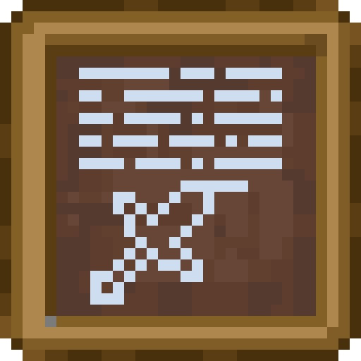

<!-- PROJECT BADGES -->
<div align="center">

[![CI][ci-badge]][ci-url]
[![Stars][stars-badge]][stars-url]
[![License][license-badge]][license-url]

</div>


<!-- PROJECT LOGO -->
<br />
<div align="center">
  
  <h3>item-serialize-utils</h3>
  <p align="center">
    Provides utils for (de)serialize items more shorter and easier!

[Report a bug][issues-url] · [Request a feature][issues-url]

  </p>
</div>


<!-- ABOUT THE PROJECT -->

## About The Project

Serializes PocketMine-MP `Item`s (single items, lists and whole inventories) to compact strings and back,
built on [presentkim/nbt-serializer][nbt-serializer-url].

- **Target server** : [axolotl-pm/PocketMine-MP][axolotl-url] (PocketMine-MP 5 fork)
- **PHP** : 8.4 or later

> Looking for the Poggit virion for upstream PocketMine-MP 5.44 and older?
> Use the [`legacy/pmmp-5.44`][legacy-url] branch. It is no longer maintained.

:heavy_check_mark: Multiple formats, all implementing `kim\present\utils\itemserialize\ItemSerializer`

| Class                  | Output                                                                      |
|------------------------|-----------------------------------------------------------------------------|
| `BinaryItemSerializer` | Big-endian NBT binary string (raw bytes, not text)                          |
| `Base64ItemSerializer` | Same as binary, encoded with `base64_encode()`                              |
| `HexItemSerializer`    | Same as binary, encoded with `bin2hex()`                                    |
| `SnbtItemSerializer`   | [SNBT (Stringified NBT)](https://minecraft.wiki/w/NBT_format#SNBT_format)   |
| `JsonItemSerializer`   | JSON object (`Count`, `Name`, `Damage`, and `Block`/`tag` as SNBT strings) |

> **NOTE** : `JsonItemSerializer` is not compatible with `Item::legacyJsonDeserialize()`

:heavy_check_mark: Single items, lists, and slot-indexed inventory contents

:heavy_check_mark: Deterministic output: the same item always becomes the same string, whatever order its NBT keys were
stored in, so results can be compared, hashed or used as keys

:heavy_check_mark: One exception type for bad input: every `deserialize*()` throws
`pocketmine\data\SavedDataLoadingException`

-----

## Installation

The package is installed with Composer. `presentkim/nbt-serializer` is not on Packagist,
so add both repositories to your project's `composer.json`
(Composer does not read `repositories` from dependencies):

```json
{
  "repositories": [
    { "type": "vcs", "url": "https://github.com/presentkim-pm/item-serialize-utils" },
    { "type": "vcs", "url": "https://github.com/presentkim-pm/nbt-serializer" }
  ],
  "require": {
    "presentkim/item-serialize-utils": "dev-main",
    "presentkim/nbt-serializer": "dev-main"
  }
}
```

`presentkim/nbt-serializer` is listed in your own `require` because Composer only accepts a `dev-main` dependency
of a dependency when the root project allows it (alternatively set `"minimum-stability": "dev"`
with `"prefer-stable": true`).

The server itself is required as `pocketmine/pocketmine-mp: ^5.0`, which `axolotl-pm/pocketmine-mp` satisfies
through `replace`.

-----

## How to use?

Every method is static. Pick a format class; they all share the same API.

```php
use kim\present\utils\itemserialize\Base64ItemSerializer;
use kim\present\utils\itemserialize\SnbtItemSerializer;
use pocketmine\data\SavedDataLoadingException;

// Single item
$contents = Base64ItemSerializer::serialize($item);
$item = Base64ItemSerializer::deserialize($contents);

// List of items (keys are discarded, the result is a list)
$contents = Base64ItemSerializer::serializeList([$itemA, $itemB]);
$items = Base64ItemSerializer::deserializeList($contents); // list<Item>

// Whole inventory, slot indices preserved, empty slots skipped
$contents = Base64ItemSerializer::serializeContents($player->getInventory()->getContents());
$player->getInventory()->setContents(Base64ItemSerializer::deserializeContents($contents)); // array<int, Item>

// Bad input
try{
    $item = SnbtItemSerializer::deserialize($userInput);
}catch(SavedDataLoadingException $e){
    // malformed contents, wrong shape (e.g. a list given to deserialize()), unknown item, ...
}
```

### Methods

| Method                                                    | Description                                                         |
|-----------------------------------------------------------|---------------------------------------------------------------------|
| `serialize(Item $item) : string`                          | Serialize one item                                                  |
| `deserialize(string $contents) : Item`                    | Deserialize one item                                                |
| `serializeList(iterable<Item> $items) : string`           | Serialize items in order, keys discarded                            |
| `deserializeList(string $contents) : list<Item>`          | Deserialize items in order                                          |
| `serializeContents(array<int, Item> $contents) : string`  | Serialize slot => item (e.g. `Inventory::getContents()`), air skipped; negative slots throw `InvalidArgumentException` |
| `deserializeContents(string $contents) : array<int, Item>`| Deserialize slot => item, sorted by slot, ready for `Inventory::setContents()` |

### Output details

- The world data version (`PMMPDataVersion`) is removed from the item and from its `Block` tag, so output does not
  change between server versions.
- Compound keys are sorted (byte order) at every depth; list order is kept.
- Contents are stored as a list of item tags, each with an extra `Slot` **int** tag (any slot index, not limited to
  the 0-255 range of the vanilla byte `Slot`). In JSON each item object gets a `Slot` integer.
- `BinaryItemSerializer` output is raw bytes. Store it in a binary-safe column (`BLOB`), or use Base64/Hex for text.

### Custom formats

Use `ItemSerializerTrait` and implement the two primitives to add a format with the same API:

```php
use kim\present\utils\itemserialize\ItemSerializer;
use kim\present\utils\itemserialize\ItemSerializerTrait;
use pocketmine\nbt\tag\Tag;

final class MyItemSerializer implements ItemSerializer{
    use ItemSerializerTrait;

    protected static function serializeTag(Tag $tag) : string{ /* ... */ }

    protected static function deserializeTag(string $contents) : Tag{ /* ... */ }
}
```

-----

## Development

```sh
composer install --ignore-platform-req='ext-*'
composer test
```

The tests run against the real `axolotl-pm/pocketmine-mp` item code. Its native extensions are not needed:
`tests/polyfill` stands in (tests only) for the few `ext-encoding` / `ext-morton` functions that item
(de)serialization touches, and is skipped when the real extensions are loaded.

-----

## License

Distributed under the **MIT**. See [LICENSE][license-url] for more information


[ci-badge]: https://img.shields.io/github/actions/workflow/status/presentkim-pm/item-serialize-utils/ci.yml?branch=main&style=for-the-badge

[ci-url]: https://github.com/presentkim-pm/item-serialize-utils/actions/workflows/ci.yml

[stars-badge]: https://img.shields.io/github/stars/presentkim-pm/item-serialize-utils.svg?style=for-the-badge

[license-badge]: https://img.shields.io/github/license/presentkim-pm/item-serialize-utils.svg?style=for-the-badge

[stars-url]: https://github.com/presentkim-pm/item-serialize-utils/stargazers

[issues-url]: https://github.com/presentkim-pm/item-serialize-utils/issues

[license-url]: https://github.com/presentkim-pm/item-serialize-utils/blob/main/LICENSE

[legacy-url]: https://github.com/presentkim-pm/item-serialize-utils/tree/legacy/pmmp-5.44

[nbt-serializer-url]: https://github.com/presentkim-pm/nbt-serializer

[axolotl-url]: https://github.com/axolotl-pm/PocketMine-MP
